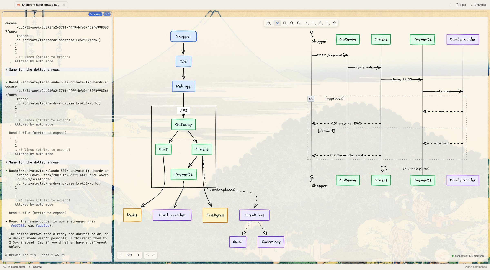
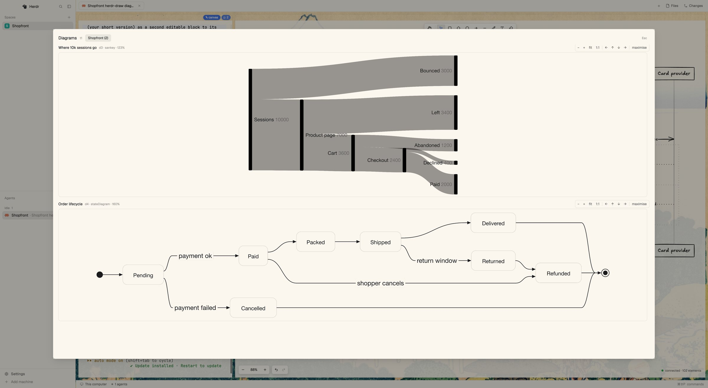

# Herdr Canvas Mod

Collaborate better with your coding agents using Mermaid and Excalidraw diagrams, right in the native
[Herdr](https://herdr.dev) app. Agents run one CLI, `herdr-draw`, to pin Mermaid diagrams to their pane and to draw
on a live Excalidraw canvas you can edit too.

<picture>
  <source media="(prefers-color-scheme: dark)" srcset="docs/images/canvas-dark.jpg">
  
</picture>

## What you get

- **Live canvas.** An Excalidraw canvas splits in beside the agent. The agent draws from its shell, often as editable
  blocks generated from Mermaid; you draw by hand; each sees the other's changes as they happen.
- **Pinned diagrams.** An agent pins Mermaid (every Mermaid 12.1 diagram type, rendered by Pele). Its pane header
  shows a `◫ 2` badge; click it for a viewer with tabs, pages, zoom and pan, in your theme's colors.
- **Other machines.** Agents on machines you added to Herdr (`hc machine add`) work the same; their diagrams and
  canvases show in your app.
- **An agent skill** for Claude Code, pi and Codex, so agents know when and how to draw.



## Install

On the machine that runs the Herdr app (Herdr 0.1.16 or newer; bun is installed if missing):

```sh
curl -fsSL https://raw.githubusercontent.com/abhirup-dev/herdr-canvas-mod/main/install.sh | sh
```

**One manual step, for the badge.** The pane header comes from the layout, and shipped layouts are read-only.
Clone yours once (this also switches to it):

```sh
herdr-app do layout.clone '{"name":"main","as":"diagrams"}'
```

Then in `~/.config/herdr-app/layouts/diagrams.json`, on the `{"tab":"active"}` block's `"pane"`, add:

```json
"header": { "content": { "mod": "diagram-pane" }, "height": 22, "position": "top", "reveal": "always" }
```

Without it the canvas still works; only the badge is missing.

## Use

Agents do this for you once the skill is installed. By hand, in any terminal inside Herdr:

```sh
printf 'flowchart LR\n  cart[Cart] --> pay[Pay]\n' | herdr-draw mermaid add --title "Checkout"   # pin; the badge appears
herdr-draw mermaid check flow.mmd          # render without pinning: errors, a PNG preview, readability
herdr-draw mermaid ls                      # tabs, ids, titles

herdr-draw canvas open                     # split the canvas beside this terminal
herdr-draw canvas block put arch arch.mmd  # Mermaid as an editable block on the canvas
herdr-draw canvas describe                 # read the scene, including what you drew by hand
```

`herdr-draw help` lists everything. The diagrams in the screenshots are in [docs/showcase](docs/showcase).

## More

- `herdr-draw doctor` checks the setup here and on your other machines; `herdr-draw uninstall` removes it.
- [RECIPE.md](RECIPE.md): each part and how it behaves.
- [docs/internals.md](docs/internals.md): CLI reference, data and logs, debugging, known limits.
