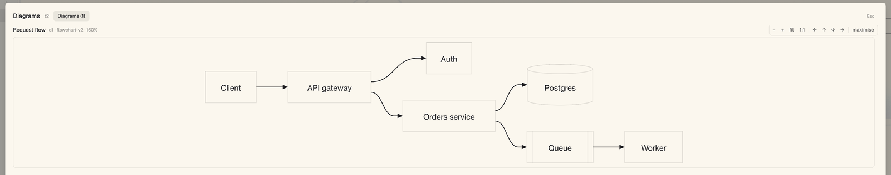

# Herdr Canvas

Diagrams beside the agent that drew them. A coding agent runs `herdr-draw` in its terminal; that pane's header then shows a pulsing `◫ 3` badge for its pinned Mermaid diagrams and, once it opened a canvas, a `✎ canvas` badge. The first opens a themed viewer with tabs, pages, zoom and pan. The second splits a live Excalidraw canvas to the right of the pane, which the agent draws on from its shell and the person edits by hand, both seeing each other's changes as they happen. Agents on other machines show up the same way.

## What you see

- **Pane header** (`diagram-pane`, 22px, top, revealed on hover): a strip over the terminal, the theme `background` at alpha `1a`, padded 6px, badges right-aligned 4px apart. Empty when the terminal has neither pins nor a canvas. Nothing else lives in it.
  - **Pin badge** `◫ N`: an 18px pill, 9px corners, 7px side padding, `accent` fill, `accent_foreground` 10.5px bold text, `shadow_md`. N counts pins over all tabs. It pulses opacity 0.7 to 1 every 1100ms.
  - **Canvas badge** `✎ canvas`: the same pill outlined 1px in `accent` on `background`, accent text; filled `accent` while this tab has a canvas pane open. Left of the pin badge.
- **Diagrams viewer** (`diagram-popup`, a dialog 85% of the window each way, `popover` fill, 18px padding, 13px text):
  - Top row: "Diagrams" 15px semibold, the terminal id 11px `dim`, a write error in `blocked` if any, then tab pills (26px tall, 6px corners, 12px, "name (count)", `selected` fill on the current one), a `‹ page 1/2 ›` pager when a tab has over 2 pins, and an `Esc` button.
  - Two pins per page, stacked. Each has a 22px title row (title semibold; `id · type · 87%` 11px `dim`; a toolbar on the right in a `popover` box with 1px border and 7px corners: `− + fit 1:1 | ← ↑ ↓ → | maximise`) over a viewport with 8px corners, 1px `border`, `background` fill, at least 120px tall.
  - The diagram is the agent's Mermaid, drawn in the live theme's colors (`background`, `foreground`, `muted`, `surface`, `raised`, `border`, `accent`) and Helvetica Neue (else Helvetica, Arial, DejaVu Sans). Fitted to its viewport, never grown past 1.6x.
  - No pins: "No diagrams pinned for <terminal> yet. An agent pins one with: herdr-draw mermaid add file.mmd".
- **Canvas pane** (`excal-canvas`, a split to the right): the scene on the theme `background` at the terminals' opacity (alpha `1-(1-o)²`, matching how terminals stack theirs). Elements look as in Excalidraw: rough hand-drawn strokes and hachure fills, text in Excalifont, Virgil, Cascadia Code or Helvetica. On a dark theme element colors go through Excalidraw's dark-mode filter. Chrome floats in "islands" (`popover`, `border`, large corners, `shadow_md`), following the theme:
  - **Tool bar**, top center, 10px down: hand, a divider, then selection, rectangle, diamond, ellipse, arrow, line, freedraw, text, eraser; 30x26 buttons with 14px SVG icons (active one `accent` on `selected`) and a 7.5px `muted` key hint (`H 1 2 3 4 5 6 7 8 0`). It wraps in a narrow pane.
  - **Properties panel**, 216px wide at left 12, top 50, shown for a selection or a shape tool. Sections fit the types: Stroke (quick `#1e1e1e #e03131 #2f9e44 #1971c2 #f08c00` plus the current swatch, which opens a shade grid and a `#` hex field), Background (transparent `⌀`, `#ffc9c9 #b2f2bb #a5d8ff #ffec99`), Fill (Hachure, Cross, Solid), Stroke width (1, 2, 4), Stroke style (solid, dashed, dotted), Sloppiness (Architect, Artist, Cartoonist), Edges (Sharp, Round), Font size (S M L XL = 16 20 28 36), Opacity (20 to 100), and with a selection Actions (duplicate, delete in `#e03131`).
  - **Footer**, bottom left: `− 100% +`, then undo and redo (35% opacity when unavailable).
  - **Status**, bottom right: a 7px dot (`#2f9e44` connected, `#f08c00` connecting, `#e03131` sidecar or server down), "connected · 12 elements", and the last handler failure if any, 11px `muted`.
  - Selection: an `accent` box 6px out with eight 8px handles; dashed per-element boxes when several are selected; round point handles (and lighter mid-segment ones) on a single line or arrow; the marquee is `accent` at alpha `14`.

## How it behaves

- An agent pins: `herdr-draw mermaid add` writes the pin; the header badge appears or counts up at once, and an open viewer reloads. The badge's pulse is set by header props: `animate` `"always"` (default), `"unseen"` (only while the newest revision is unopened) or `"never"`; `period` in ms.
- Click the pin badge: the viewer opens for that pane's terminal and marks it seen. `herdr-app do mod.open --name diagram-popup` opens it for the focused pane.
- In the viewer: drag or scroll pans a diagram; pinch zooms at the pointer; double-click maximises it to fill the area (and back). Toolbar zooms by 1.25x (up to 3x on screen), fits, shows 1:1, pans 80px per press. Keys: `←`/`→` pages, `↑`/`↓` or `1`-`9` tabs, `+` `-` `0` zoom and fit the first shown pin, `f` maximises (arrows then pan); `Esc` restores, then closes. A theme change recolors the diagrams.
- An agent runs `herdr-draw canvas open`: the canvas splits in to the right of the agent's pane and its header gains `✎ canvas`. Clicking that badge closes the canvas pane in this tab, or starts the sidecar and splits it in again.
- On the canvas: the camera keeps fitting the scene as it changes until the person clicks, pans or zooms; `shift-1` fits again and resumes that, `shift-0` is 100%, `+`/`-` zoom 1.1x, as do the footer buttons (the percentage resets to 100%). Scroll pans, pinch zooms, space-drag, the hand tool or the middle button pan.
- Tools by key: `h` hand (again: back to the previous tool), `v`/`1` selection, `r`/`2`, `d`/`3`, `o`/`4`, `a`/`5`, `l`/`6`, `p`/`x`/`7`, `t`/`8`, `e`/`0`. Drag to create, move, resize and bend lines; shift-click toggles an element in the selection; the eraser fades what it will delete. `backspace`/`delete`, `escape` (selection tool, nothing selected), `cmd-a`, `ctrl-d` duplicate, arrows nudge 1px (shift 10px), `cmd-z`/`cmd-shift-z` undo and redo on the board. Text opens an auto-growing field; `Esc` or clicking away commits, and empty text deletes it.
- Agent edits from the shell land in the pane within a frame; the person's edits are on the board the agent reads with `herdr-draw canvas get`/`describe`/`screenshot`. If the sidecar drops, the dot goes red and the pane retries every 250ms to 4s.

## Built from

- **`mods/diagram-pane`** (plain JS): `mod.json` `{ "place": "none", "title": "Pane header", "cloned_from": { "name": "pane", "version": "0.1.10" } }`, but only the badges are kept. A layout sets it as a pane header: `"header": { "content": { "mod": "diagram-pane", "props": { "animate": "always", "period": 1100 } }, "height": 22, "position": "top", "reveal": "hover" }`. Reads `props().pane`/`props().terminal` from Herdr. Uses `watchFolder`, `readTextFile`, `shared`/`setShared` (`diagram.seen.<terminal>` = last opened `rev`), `panes()`, `openOverlay({ mod: "diagram-popup", props: { terminal }, kind: "dialog", width: 0.85, height: 0.85 })`, `run("pane.close", {pane})`, `run("pane.split", { pane, direction: "right", mod: "excal-canvas", props: { board: terminal, port: 3077 } })`, `exec("~/.local/bin/herdr-draw", ["canvas", "start"])`, `theme()`, `checking()`, `gpui-base` `h_flex`.
- **`mods/diagram-popup`** (plain JS): `mod.json` `{ "place": "none", "title": "Diagrams", "overlay": { "kind": "dialog", "width": 0.85, "height": 0.85 } }`. Props `{ terminal, overlay }` (falls back to `focused()`). Uses `watchFolder`, `readTextFile`/`writeTextFile`, `image()`, `fonts()`, `settings().zoom`, `theme()`, `closeOverlay`, `on_pinch`, `on_size_change`, `track_focus`.
- **`excal-canvas`**: TypeScript in `src/canvas-mod/` (`main.ts` view and input, `ui.ts` chrome, `paths.ts` paints to `PathBuilder` paths, `log.ts`) plus shared `src/canvas/` (camera, editor, scene, protocol, Excalidraw dark color). `bun run build:mod` bundles it to `dist/mods/excal-canvas/main.js` (ESM, externals `gpui-kit gpui-base herdr websocket fs/promises`), copies `mod.json` `{ "place": "none", "title": "Excalidraw canvas", "focusable": true }`, `icons/*.svg` (16 icons) and `fonts/` (Excalifont, Virgil, Cascadia Code `.ttf` with `LICENSES.md`), then runs `scripts/check-bundle.ts`. Props `{ board, port }` (default `"default"`, 3077). Uses `websocket`'s `WebSocket.connect("ws://127.0.0.1:<port>")`, `window.paint_path`, `gpui-base` `Textarea`/`TextareaState`/`Input`/`InputState`, `svg()` icons at `mods/excal-canvas/icons/<name>.svg`, `layout().terminal_opacity` (else `settings()`), `cx.timer.after`.
- **Data**: pins in `<app home>/data/herdr-agent-diagram/<terminal>/state.json` (`{ rev, tabs: [{ name, pins: [{ id, title, type, rev, width, height, svg }] }] }`), raw Pele SVGs `<pin>-r<rev>.svg` (CSS variables intact), `<pin>.png` previews, and `canvas.json` (marks "this terminal drew"). The viewer writes themed copies `<pin>-r<rev>.<theme hash>.svg` beside them. Remote terminals live under `<machine>/<terminal>`. Mod logs go to `<app home>/data/herdr-draw/logs/mod-<name>.log` (last 300 lines).
- **`herdr-draw` CLI** (Node/Bun, `cac`): `mermaid add|replace|remove|check|ls|clear` renders with `pele` and `@resvg/resvg-js`; `canvas open|start|status` and the board commands. `canvas open` writes `canvas.json` and runs `herdr-app do pane.split` beside `$HC_TERMINAL_ID`'s pane (found via `herdr-app ls`).
- **Sidecar** (Bun, one per machine, port `CANVAS_SIDECAR_PORT` 3077): holds every board in memory (trimmed from `mcp-excalidraw-server` 2.1.2, `@excalidraw/element`, `roughjs` 4.6.6 for the rough paints), serves REST at `/b/<board>/api` and the mod websocket on the same port, saves boards to `~/.local/state/herdr-draw/boards/`. For synced machines it relays boards and mirrors pins over an `hc attach` stream.
- **Install**: `herdr-draw install` builds the canvas mod and copies the three folders into `<app home>/mods/`, plus the agent skill `skills/herdr-canvas-mod`.

## Watch out

- The mod runtime is embedded V8 with no DOM, Node, `Intl`, `TextEncoder`/`TextDecoder`, `WebAssembly`, `require`, `setTimeout` or `RegExp.$1`. `check-bundle.ts` fails the build on any of them; use `cx.timer` and `cx.spawn`.
- Herdr silently kills mod code past about 50ms per render, 500ms per handler, 5s per spawned task. Rough paths are generated in the sidecar, not the mod; `paths.ts` stays scalar (no tuple returns, destructuring or spread: one rectangle once took seconds) and caches built paths per element, zoom and stretch.
- Handler exceptions vanish: the canvas wraps handlers to show failures in the status line and renders a render error as red text in the pane.
- `.w()`, `.left()`, text and `paint_path` are multiplied by the app zoom; pointer positions, scroll deltas and `on_size_change` sizes are not. Divide by `settings().zoom` once where they come in, never twice.
- GPUI's SVG rasteriser has no CSS variables and sees only installed fonts (not Herdr's bundled Geist), hence the viewer's color and font substitution. It draws one frame: Mermaid edge animations don't play.
- Mods can only write under the app home, which is why pin data and mod logs live there and SVGs are referenced by app-home-relative path.
- `watchFolder` on the parent `data/herdr-agent-diagram`: the terminal's folder may not exist before the first pin, and a batch holding the root itself means refresh everything. The viewer must ignore its own themed `.<hash>.svg` writes or it loops.
- Module code outlives view copies, so the logger borrows a live view's `cx` and gives it back in `close()`.
- `mod.open` can't pass props; opened that way the viewer shows the focused pane. `herdr-app check` doesn't run deferred renders, so test tab switches in the app.
- A pane header is a single slot and shipped layouts are read-only: clone one (`layout.clone`) and set its pane header to `diagram-pane`. Without that, there is no badge; `canvas open` still splits.
- `canvas open` splits every time (mod panes aren't in `herdr-app ls`). The canvas badge only finds an open canvas in the same tab.
- Remote pane ids contain `/`; element ids go through a `[^A-Za-z0-9_-]` to `_` filter.
- The canvas mod's folder must be named `excal-canvas`: icon paths are hard-coded to `mods/excal-canvas/icons`. Install by copying the built `dist/` folder, not linking (the app watches its mods folder, not link targets).
- `cmd-d` is Herdr's split, so duplicate is `ctrl-d`. Needs Herdr 0.1.16+ (`on_pinch`, `checking()`), and bun 1.4+ for the sidecar.

## Done when

- `bun run build:mod` prints "runtime check ok", `bun test` passes, and `herdr-app check` passes for `diagram-pane`, `diagram-popup` and `excal-canvas`.
- In a layout whose pane header is `diagram-pane`, `printf 'flowchart TD\n  a[Cart] --> b[Pay]\n' | herdr-draw mermaid add --title Checkout` shows a pulsing `◫ 1` on that pane at once.
- Clicking it opens "Diagrams" with a Checkout tab whose diagram uses the theme's colors; switching theme recolors it; `f`, arrows and `Esc` maximise, pan, restore and close.
- A third pin in one tab brings the `page 1/2` pager; `mermaid remove` drops the count live.
- `herdr-draw canvas open` splits the canvas right of the agent with a green "connected · 0 elements" status and adds a filled `✎ canvas` badge; clicking it closes the pane and clicking again reopens it.
- A rectangle added with `herdr-draw canvas add` appears in the pane; one drawn by hand shows up in `herdr-draw canvas describe`; `cmd-z` removes it.
