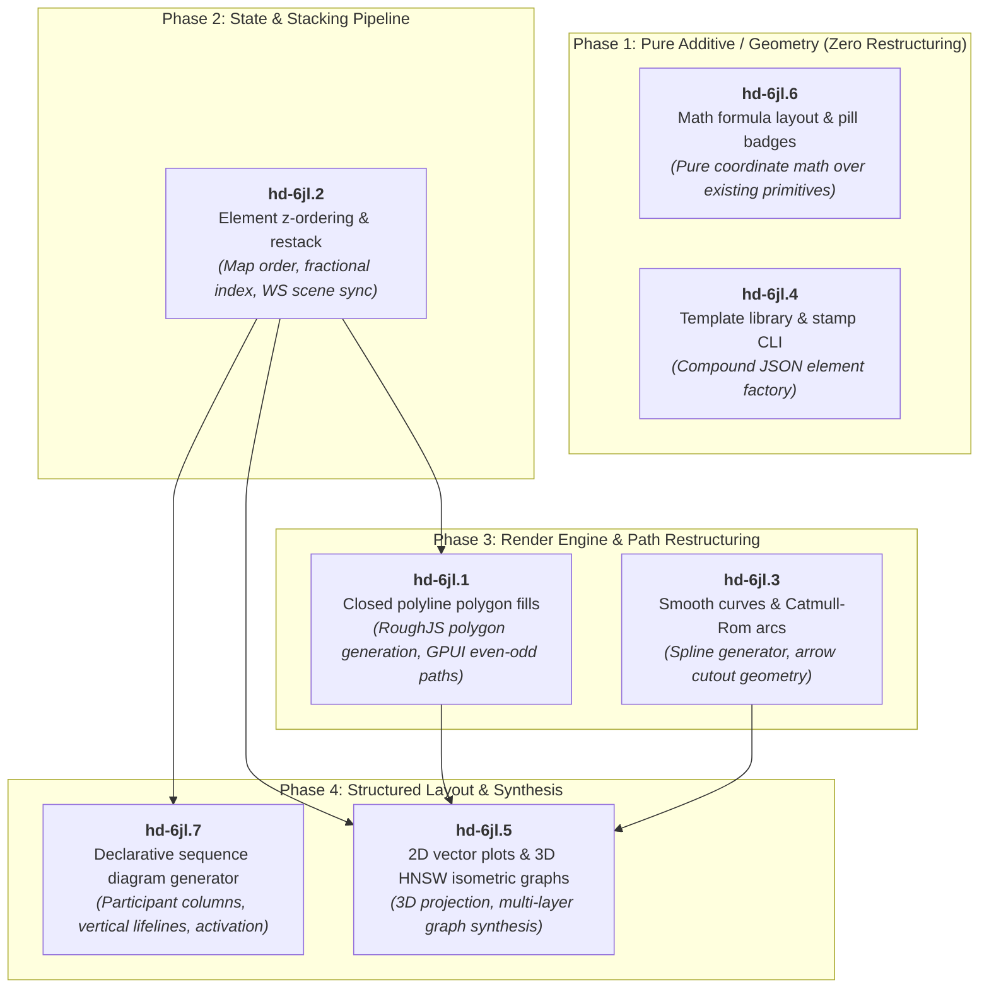

# Research & Architecture: Structured Layouts, Code-First Diagramming, and Scene Directing

> **Document Type:** Architecture & Technical Research Document  
> **Topic:** Next-Generation Visual Capabilities for the Herdr Canvas Mod  
> **Status:** Draft / Exploratory  
> **Related Beads Epic:** `hd-6jl` (*Rich visualization support: 2D/3D charts, isometric planes, polygon fills, and diagram templates*)

---

## 1. Executive Summary

A recent audit of high-density technical infographics (such as vector index explainers with 2D/3D coordinate planes, HNSW multi-layer isometric skip graphs, Voronoi partitions, math derivations, and sequence diagrams) highlighted a fundamental bottleneck:

> **The Coordinate Trap:** When an AI agent must manually compute hundreds of raw Cartesian numbers ($x, y, \text{width}, \text{height}$) to draw complex diagrams, layout drift, element collisions, and overlapping shapes are inevitable. Furthermore, minor edits (such as inserting a step into a sequence diagram) require recalibrating every downstream element.

This document synthesizes:
1. **The Core Engine Primitives** required to support rich visual forms (represented in Beads epic `hd-6jl`).
2. **The Code-First / DSL Paradigm**, allowing agents to define diagrams as typed TypeScript or declarative schemas compiled via external graph solvers (Dagre, ELK.js) instead of writing raw JSON.
3. **Cinematic Scene Directing**, enabling agents to programmatically choreograph camera movements, frame transitions, and interactive guided tours.

---

## 2. Beads Issue Map & Dependency Architecture

All tracked tasks under epic **`hd-6jl`** are structured below in ascending order of implementation complexity, preserving critical architectural dependencies:



### Detailed Issue Breakdown

| Issue ID | Priority | Scope | Description & Restructuring Impact |
|---|---|---|---|
| **`hd-6jl.6`** | P3 | Additive | **Math formula layout helpers & equation pill badges**<br>Utility to lay out fractions, square roots, and result pills (`cos(a,b) = 0.98`) cleanly using standard text and line elements. Zero engine restructuring. |
| **`hd-6jl.4`** | P2 | CLI / Client | **Canvas component template library and `stamp` CLI**<br>`herdr-draw canvas stamp <template> --at x,y` with built-in presets (`axes-2d`, `isometric-plane`, `step-card`, `metric-pill`). Inserts grouped compound shapes with generated IDs. |
| **`hd-6jl.2`** | P1 | Engine State | **Element z-ordering and restack commands**<br>Implements `bringToFront`, `sendToBack`, `bringForward`, and `sendBackward` in store, CLI (`arrange restack`), and WebSocket sync. Eliminates the requirement to draw background zones first. |
| **`hd-6jl.3`** | P2 | Geometry | **Smooth curved lines and Catmull-Rom arcs**<br>Enables Excalidraw's `roundness: { type: 2 }` on linear elements. Updates `shape.ts` arrow cutout math and tangents so angle arcs ($\theta$) and curved pointer arrows render smoothly. |
| **`hd-6jl.1`** | P1 | Render Engine | **Closed polyline polygon fills (Isometric Planes & Voronoi Cells)**<br>Allows multi-point `line` elements to accept `backgroundColor` and `fillStyle`. Requires modifying `src/canvas/edit.ts`, invoking RoughJS `polygon()` in `shape.ts`, and handling GPUI path winding. |
| **`hd-6jl.7`** | P2 | Layout Engine | **Declarative sequence diagram generator & structural layout engine**<br>Compiles high-level sequence schemas (participants, sync/async/reply events) into automatically spaced lifelines and arrows. Enables reliable insertion/deletion without coordinate drift. |
| **`hd-6jl.5`** | P2 | Synthesis | **Parametric generators for 2D vector plots & 3D HNSW graphs**<br>Combines isometric projection formulas, polygon fills (`hd-6jl.1`), z-ordering (`hd-6jl.2`), and spline arcs (`hd-6jl.3`) into automated generators for complex multi-layer graphs. |

---

## 3. Code-First & Typed Diagramming

### 3.1 The Open-Source Precedents
In the wider Excalidraw ecosystem, raw JSON has already been superseded by code-driven workflows:
* **`ExcalidrawAutomate` (Obsidian Excalidraw):** An imperative TypeScript/JavaScript scripting API (`ea.addRect()`, `ea.connectObjects()`) allowing programmatic generation, batch updates, and community macro scripts.
* **`excalidraw-cli` & `excalidraw-dsl`:** Text-based DSLs that compile directly to Excalidraw schemas via headless layout engines (**ELK.js**, **Dagre**, or **Graphviz**).
* **`@excalidraw/mermaid-to-excalidraw`:** Upstream Excalidraw's parser that compiles declarative Mermaid graph strings into Excalidraw element trees.

### 3.2 The Agent Code-First Model
Rather than having an LLM generate JSON directly:

```ts
// Example: An agent emits or modifies a typed TypeScript diagram specification
import { Canvas, SequenceDiagram } from "herdr-draw/dsl";

const canvas = new Canvas();
const seq = new SequenceDiagram({ origin: [100, 100], spacing: 220, stepHeight: 60 });

const client = seq.addActor("Client", { style: "pill" });
const gateway = seq.addActor("API Gateway");
const auth = seq.addActor("Auth Service");

seq.send(client, gateway, "POST /v1/login");
seq.send(gateway, auth, "verifyCredentials()", { sync: true });
seq.reply(auth, gateway, "token { exp, sub }");
seq.reply(gateway, client, "200 OK (JWT)");

export default seq.compile();
```

### 3.3 Key Advantages for AI Agents
1. **Durable Source of Truth:** The agent stores `diagram.ts` in the project. When asked to make a change, it updates the code rather than reverse-engineering bounding boxes from existing canvas elements.
2. **Deterministic Layout Math:** Column spacing, lifeline vertical drops, and arrow horizontal alignments are calculated by the compiler with zero floating-point hallucination.
3. **Bidirectional Semantic IDs:** Generated elements receive predictable IDs (`actor-gateway`, `lifeline-gateway`, `step-3-arrow`). Edits target semantic entities rather than arbitrary hashes.

---

## 4. In-Scope Classical Diagram Types

With the engine capabilities established in `hd-6jl` and a declarative layout layer, the following classical diagram formats become reliably supportable:

```
┌────────────────────────────────────────────────────────────────────────┐
│                   Classical Diagrams In Scope                          │
├────────────────────────────┬───────────────────────────────────────────┤
│ Sequence Diagrams          │ Lifelines, activations, sync/async calls  │
├────────────────────────────┼───────────────────────────────────────────┤
│ Architecture / Zones       │ Cloud boundaries, VPCs, network tiers     │
├────────────────────────────┼───────────────────────────────────────────┤
│ State Machines             │ States, terminal nodes, curved loopbacks  │
├────────────────────────────┼───────────────────────────────────────────┤
│ Swimlane Flowcharts        │ Cross-functional lanes, decision diamonds │
├────────────────────────────┼───────────────────────────────────────────┤
│ Entity-Relationship (ER)   │ Table schemas, PK/FK headers, cardinality │
├────────────────────────────┼───────────────────────────────────────────┤
│ Git / DAG Graphs           │ Branching commit trains, merge nodes      │
├────────────────────────────┼───────────────────────────────────────────┤
│ 3D Isometric Stacks        │ Multi-layer networks, HNSW vector planes  │
└────────────────────────────┴───────────────────────────────────────────┘
```

---

## 5. Scene Directing & Camera Choreography

A major frontier for human-agent collaboration is treating the canvas as an interactive presentation viewport rather than a static bulletin board.

### 5.1 Protocol Extension: Camera Directives
By extending `src/canvas/protocol.ts`, the sidecar can stream camera instructions to the native mod:

```ts
export type CameraMessage =
  | { 
      readonly type: "camera_pan"; 
      readonly target: { x: number; y: number }; 
      readonly zoom?: number; 
      readonly durationMs?: number; 
      readonly easing?: "linear" | "easeOut" | "easeInOut"; 
    }
  | { 
      readonly type: "camera_focus"; 
      readonly elementIds: readonly string[]; 
      readonly padding?: number; 
      readonly durationMs?: number; 
    }
  | { 
      readonly type: "camera_track"; 
      readonly elementId: string; 
    };
```

### 5.2 What the "Agent Director" Enables
* **Guided Technical Walkthroughs:** When explaining an architectural flow or code execution path, the agent pans the viewport to each component as it explains it in chat:
  ```bash
  herdr-draw canvas camera focus --ids api-gateway --duration 400
  # Agent: "First, requests enter through the API Gateway..."
  herdr-draw canvas camera focus --ids auth-service,db-cluster --duration 600
  # Agent: "Next, credentials are authenticated against the database cluster."
  ```
* **Follow-the-Agent Drawing:** As an agent generates a sprawling layout, it automatically pans the viewport to the active bounding box so the user watches the diagram build in real time without manually scrolling.
* **Slide & Frame Presentations:** Native Excalidraw `frame` elements serve as slide definitions. A simple `herdr-draw canvas present --next` advances the camera to frame $N$, centered and scaled.

---

## 6. Recommended Next Steps

1. **Foundational Engine PRs:** Pick up `hd-6jl.2` (z-ordering) and `hd-6jl.1` (closed polygon fills).
2. **Template Library:** Introduce `hd-6jl.4` (`herdr-draw canvas stamp`) to immediately accelerate basic compound shape insertion.
3. **Declarative Layout Engine:** Implement `hd-6jl.7` for sequence diagrams and standard Dagre/ELK-based DAG graph generation.
4. **Camera Stream Integration:** Add camera messages to `protocol.ts` and `main.ts` to unlock interactive agent presentations.
